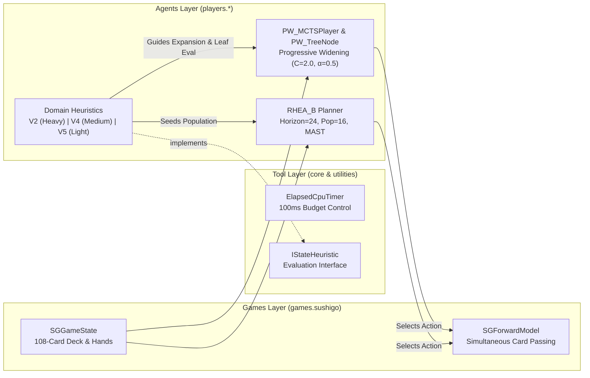
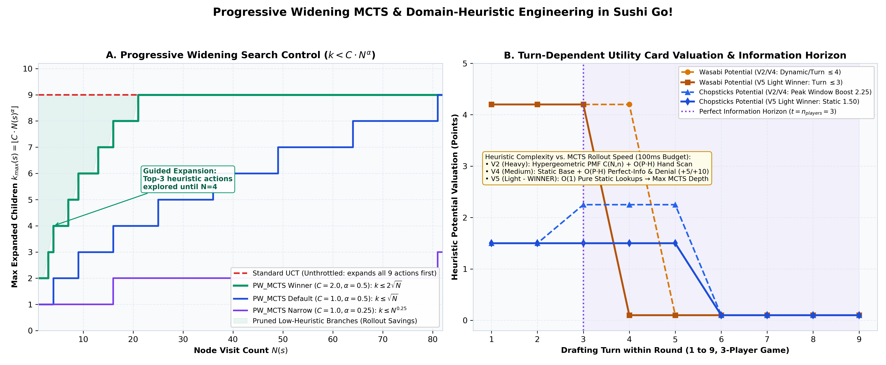
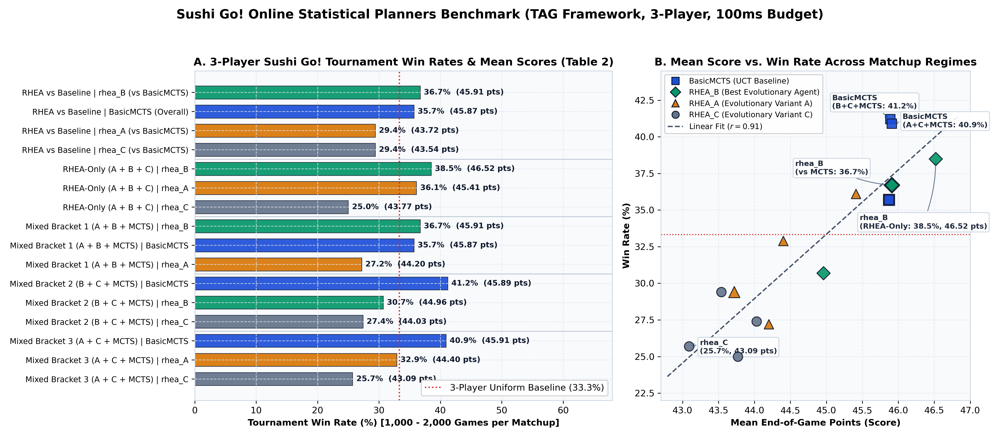

# Progressive Widening MCTS & Domain-Heuristic Engineering for *Sushi Go!* in TAG

[](https://openjdk.org/)
[-1D4ED8)](https://github.com/GAIGResearch/TabletopGames)
[](src/main/java/players/PW_MCTS/)
[](configs/PW_Heuristics_Light_WINNER.json)
[](https://github.com/Ceviche98/sushigo-progressive-widening-mcts/actions/workflows/ci.yml)
[](LICENSE)

> **Research & Engineering Repository (ECS7032P — Artificial Intelligence in Games)**  
> **Authors:** Oscar More, Mohamed, and Airam  
> **Target Environment:** *Sushi Go!* within the [Tabletop Games (TAG)](https://github.com/GAIGResearch/TabletopGames) General Game Playing Framework

---

## Abstract

Drafting card games such as ***Sushi Go!*** provide a rich microcosm for studying **online statistical planning under uncertainty**. Each round begins with high stochasticity due to fresh deck shuffles and hidden opponent hands. However, after $n_{\text{players}} - 1$ card passes, the round undergoes a phase transition into **nearly perfect information**, where the exact pool of circulating cards becomes observable. Decisions involve non-zero-sum multi-player competition and delayed, non-linear rewards—ranging from *Sashimi* triplets and *Tempura* pairs to *Wasabi–Nigiri* sequential multipliers, *Dumpling* threshold progressions, and end-of-game *Pudding* majority/minority penalties.

In this project, we formulate *Sushi Go!* as an online planning problem under a strict **100 ms per-move compute budget** (`BUDGET_TIME`) and investigate three core algorithmic pillars:
1. **Progressive Widening Monte Carlo Tree Search (`PW_MCTS`):** A custom MCTS architecture that throttles tree branching via $k_{\max}(s) = C \cdot N(s)^\alpha$ and replaces uniform random node expansion with **heuristic-guided action expansion** (`guidedExpand`).
2. **Domain-Specific State Heuristics (`V2` Heavy vs. `V4` Medium vs. `V5` Light):** An ablation of three progressively streamlined heuristic evaluators isolating the **Simulation Throughput vs. Evaluation Complexity Trade-off** in determinized open-loop/closed-loop MCTS.
3. **Rolling Horizon Evolutionary Algorithms (`RHEA_B`) vs. Tree Search Baselines:** Large-scale 3-player tournament evaluations (1,000–2,000 games per bracket) benchmarking evolutionary horizon planning with MAST and shift-buffer reuse against UCT and Progressive Widening MCTS.

---

## 1. Problem Formulation & The *Sushi Go!* Environment

### 1.1 The Three-Layer Tabletop Games (TAG) Architecture

Our agents are engineered for the **Tabletop Games (TAG)** framework, which decouples General Game Playing (GGP) research into three modular layers:



* **Tool Layer (`core`, `utilities`):** Hosts game-independent utilities, forward-model wrappers, CPU timers (`ElapsedCpuTimer`), and base interfaces (`IStateHeuristic`, `PlayerParameters`).
* **Agents Layer (`players.*`):** Contains the decision-making intelligence. An agent receives a (determinized) copy of `AbstractGameState`, queries the forward model within its computational budget, and returns an `AbstractAction`.
* **Games Layer (`games.sushigo`):** Encapsulates the rules, simultaneous card-drafting state transitions, and round/game-end scoring mechanics of *Sushi Go!*.

### 1.2 Game Mechanics & Information Flow in *Sushi Go!*

Designed by Phil Walker-Harding (2013), *Sushi Go!* is played over **3 rounds** by 2 to 5 players (9 cards dealt per player per round in a 3-player game from a 108-card deck). At each turn, all players simultaneously select one card from their hand (or two cards if activating previously played *Chopsticks*), reveal their choices, and pass their remaining hand to the adjacent neighbor.

A critical strategic factor is the **direction of hand passing**: while standard rules pass hands to the left in every round, the alternating variant passes **left in Rounds 1 and 3, and right in Round 2**. Furthermore, in an $n$-player game, once $n - 1$ turns have elapsed (Turn index $t = n - 1$, i.e., Turn 3 in a 3-player match), every player has inspected every hand in circulation. An AI planner must therefore navigate two distinct epistemic regimes within every single round:
1. **Early Uncertain Phase ($t < n - 1$):** Unseen opponent hands require probabilistic reasoning over the remaining deck and risk control against over-committing to low-probability sets.
2. **Late Perfect-Information Phase ($t \ge n - 1$):** The exact card pool in play is known (though hidden hands are re-determinized by the TAG framework during simulations), shifting priority toward set completion and opponent denial.

#### Table 1: Core Card Types and Scoring Mechanisms in the 108-Card *Sushi Go!* Deck

| Card Name | Deck Qty | Scoring Mechanism | Special Rules & Strategic Interactions |
| :--- | :---: | :--- | :--- |
| **Tempura** | 14 | Pair of $2 = 5\text{ pts}$; single card $= 0\text{ pts}$ | Multiple pairs can be scored in a single round ($2.50\text{ pts/card}$ when paired). |
| **Sashimi** | 14 | Set of $3 = 10\text{ pts}$; $1$ or $2\text{ cards} = 0\text{ pts}$ | High-risk, high-reward ($3.33\text{ pts/card}$); vulnerable to opponent denial. |
| **Dumpling** | 14 | $1 \to 1\text{ pt};\; 2 \to 3\text{ pts};\; 3 \to 6\text{ pts};\; 4 \to 10\text{ pts};\; 5+ \to 15\text{ pts}$ | Nonlinear convex marginal gains ($+1, +2, +3, +4, +5\text{ pts}$) up to 5 cards. |
| **Maki Roll (3 icons)** | 8 | Provides $3$ Maki icons | Round-end majority: Most icons $= 6\text{ pts}$; second most $= 3\text{ pts}$. |
| **Maki Roll (2 icons)** | 12 | Provides $2$ Maki icons | Ties split points (rounded down); first-place tie voids second-place award. |
| **Maki Roll (1 icon)** | 6 | Provides $1$ Maki icon | Low efficiency alone, used for tie-breaking or securing second place ($3\text{ pts}$). |
| **Squid Nigiri** | 5 | Worth $3\text{ pts}$ immediately | Tripled to **$9\text{ pts}$** ($+6\text{ net bonus}$) if played onto an open *Wasabi*. |
| **Salmon Nigiri** | 10 | Worth $2\text{ pts}$ immediately | Tripled to **$6\text{ pts}$** ($+4\text{ net bonus}$) if played onto an open *Wasabi*. |
| **Egg Nigiri** | 5 | Worth $1\text{ pt}$ immediately | Tripled to **$3\text{ pts}$** ($+2\text{ net bonus}$) if played onto an open *Wasabi*. |
| **Wasabi** | 6 | $0\text{ pts}$ if left uncombined | Must be played *before* a Nigiri card; triples the next Nigiri played that round. |
| **Chopsticks** | 4 | $0\text{ pts}$ directly | Allows drafting **2 cards** on a subsequent turn, returning *Chopsticks* to the hand. |
| **Pudding** | 10 | Scored only at **end of Round 3** | Persistent across rounds: Most Puddings $= +6\text{ pts}$; fewest $= -6\text{ pts}$ (in $3+$ players). |

---

## 2. Algorithmic Architecture

### 2.1 Progressive Widening MCTS (`players.PW_MCTS`)

Standard Monte Carlo Tree Search with Upper Confidence Bounds for Trees (UCT) must expand **every available legal action** at a node before applying UCB1 selection to deepen the tree. In *Sushi Go!*, early-round hands contain $9\text{--}10$ cards, and holding an active *Chopsticks* card expands the legal action space to $H + \binom{H}{2}$ combinations (up to $45$ legal moves). Under a tight **100 ms real-time budget**, standard UCT suffers from severe shallow exploration—wasting forward-model calls on clearly suboptimal cards (e.g., playing *Wasabi* on the final turn of a round or drafting a first *Sashimi* with two turns remaining).

To overcome this bottleneck, we implemented **Progressive Widening MCTS** ([`PW_MCTSPlayer.java`](src/main/java/players/PW_MCTS/PW_MCTSPlayer.java), [`PW_MCTSParams.java`](src/main/java/players/PW_MCTS/PW_MCTSParams.java), [`PW_TreeNode.java`](src/main/java/players/PW_MCTS/PW_TreeNode.java)):

#### 1. Progressive Widening Expansion Schedule
At any node $s$ with visit count $N(s)$ and $k(s) = |\mathcal{A}_{\text{expanded}}(s)|$ currently expanded children, the tree policy (`PW_TreeNode.treePolicy()`) permits expanding a new child action if and only if unexpanded actions remain and:

$$k(s) < C \cdot N(s)^\alpha \quad \text{or} \quad N(s) = 0$$

where $C > 0$ (`progressiveWideningC`) is the widening scale constant and $\alpha \in (0, 1)$ (`progressiveWideningAlpha`) is the widening exponent. In our winning tournament configuration ([`PW_Heuristics_Light_WINNER.json`](configs/PW_Heuristics_Light_WINNER.json)), we set **$C = 2.0$** and **$\alpha = 0.5$**, yielding $k_{\max}(s) = \lfloor 2\sqrt{N(s)} \rfloor$:
* On the first visit ($N=1$), at most $2$ candidate actions are expanded before UCB selection deepens the search.
* A 4th action is not expanded until $N=4$; a 6th action requires $N=9$; all $9$ hand cards are only expanded if the node is visited $N \ge 21$ times.

#### 2. Heuristic-Guided Node Expansion (`guidedExpand`)
When Progressive Widening triggers an expansion at node $s$, `PW_TreeNode.guidedExpand()` does **not** sample an unexpanded action at random. Instead, it performs a 1-step lookahead across all unexpanded actions $a \in \mathcal{A}_{\text{unexpanded}}(s)$:

$$a^* = \arg\max_{a \in \mathcal{A}_{\text{unexpanded}}(s)} \Big[ H\big(\mathcal{T}(s, a),\, p_{\text{root}}\big) + \xi(\epsilon) \Big]$$

where $\mathcal{T}(s, a)$ advances a cloned game state via `player.getForwardModel().next(nextState, action.copy())` (accurately incrementing `root.fmCallsCount`), $H(\cdot, p_{\text{root}})$ is the configured `IStateHeuristic`, and $\xi(\epsilon)$ is tie-breaking uniform noise (`epsilon = 1e-6`). Consequently, the search tree expands strictly in descending order of domain-heuristic promise.

#### 3. Multi-Player UCB1 Selection & Rollout Policy
When $k(s) \ge C \cdot N(s)^\alpha$, `PW_TreeNode.ucb()` selects among the **already expanded** children $\mathcal{A}_{\text{expanded}}(s)$ using UCB1 with opponent sign inversion:

$$\text{UCT}(s, a) = \sigma(s) \frac{V(s, a)}{n(s, a) + \epsilon} + K \sqrt{\frac{\ln(N(s) + 1)}{n(s, a) + \epsilon}} + \xi(\epsilon), \qquad \sigma(s) = \begin{cases} +1 & \text{if } \text{player}(s) = p_{\text{root}} \\ -1 & \text{otherwise} \end{cases}$$

From the selected leaf node, `rollOut()` executes a simulation up to `rolloutLength = 30` actions using a fast uniform random policy (`RandomPlayer`), evaluates the terminal or horizon state with $H(s_{\text{leaf}}, p_{\text{root}})$, and backpropagates the scalar return up to the root (`backUp(delta)`). At the end of the 100 ms budget, `bestAction()` selects the root action with the **highest visit count** $\arg\max_a n(s_{\text{root}}, a)$ (robust child selection).

---

### 2.2 Rolling Horizon Evolutionary Algorithm (`configs/RHEA_B.json`)

As an evolutionary planning counterpart to MCTS, we configured and tuned three Rolling Horizon Evolutionary Algorithm variants (`rhea_A`, `rhea_B`, `rhea_C`), with **`RHEA_B`** ([`configs/RHEA_B.json`](configs/RHEA_B.json)) emerging as the strongest evolutionary agent:
* **Action Sequence Evolution:** Maintains a population of `populationSize = 16` candidate macro-action plans over a planning horizon of `horizon = 24` steps with temporal reward discounting (`discountFactor = 0.93`).
* **Genetic Operators:** Uses Tournament Selection (`tournamentSize = 3`), Uniform Crossover (`crossoverType = "UNIFORM"`), and mutates `mutationCount = 3` genes per offspring to generate `childCount = 14` children per generation while preserving `eliteCount = 2` elites.
* **Warm-Starting & Enhancement Mechanisms:** Employs **shift-buffer plan reuse** across turns (`shiftLeft = true`), **MAST** (Move-Average Sampling Technique, `useMAST = true`) during mutations/rollouts, and **heuristic seeding** (`seedFromHeuristic = 10`).

---

## 3. Domain-Specific Heuristic Engineering (`V2` vs. `V4` vs. `V5`)

A central contribution of our architecture is the **Score + Unrealized Potential Decomposition** shared across all three custom heuristics in `src/main/java/players/heuristics/`:

$$H(s, i) = \underbrace{\text{Score}_{\text{realized}}(s, i)}_{\text{state.getGameScore}(i)} + \sum_{c \in \{\text{Wasabi, Tempura, Sashimi, Maki, Pudding, Chopsticks, Dumpling}\}} \Phi_c(s, i)$$

Because `state.getGameScore(i)` in TAG already accounts for scored Nigiris, completed Tempura pairs, completed Sashimi triplets, and current Dumpling nonlinear points, our helper functions $\Phi_c(s, i)$ evaluate **only the unrealized marginal potential** of incomplete sets and end-of-round/end-of-game cards on the board.



### 3.1 `SushiGoHeuristic_V2` (Heavy — Dynamic Hypergeometric PMF + Perfect Information)
Implemented in [`SushiGoHeuristic_V2.java`](src/main/java/players/heuristics/SushiGoHeuristic_V2.java) (610 lines), `V2` performs exact probabilistic card counting across rounds:
* **Dynamic Hypergeometric Weight Recalculation:** At the start of each round $r \in \{0, 1, 2\}$, `recalculateBaseWeights()` tracks all cards played in prior rounds (`getPlayedCardTypesAllGame()`) to determine the remaining population $N = 108 - r \cdot (n_{\text{players}} \cdot H)$ and remaining copies $K_c$ of each card type $c$. Given sample size $n = n_{\text{players}} \cdot H$ dealt into the current round, it evaluates the exact **Hypergeometric Probability Mass Function**:

$$P(X = k) = \frac{\binom{K_c}{k}\binom{N - K_c}{n - k}}{\binom{N}{n}}$$

  From this distribution, `V2` computes the probability that enough copies exist in the round to complete a 1st or 2nd *Sashimi* set ($P(X \ge 3)$, $P(X \ge 6)$) or 1st/2nd/3rd *Tempura* pair ($P(X \ge 2, 4, 6)$), scaled by empirical multi-player competition factors ($P_{\text{comp, Sashimi}} = 0.60$, $P_{\text{comp, Tempura}} = 0.85$) and maximum points-per-card ($\text{PPC}_{\text{Sashimi}} = \frac{10}{3}$, $\text{PPC}_{\text{Tempura}} = \frac{5}{2}$).
* **Perfect Information Phase Switch ($t \ge n_{\text{players}} - 1$):** Once all hands have been seen (`getPerfectInfoTurn`), `V2` switches from probabilistic expectations to scanning all player hands (`state.getPlayerHands()`) to verify whether the exact playable pool `myRemainder + cardsInAllHands` can still complete an open *Tempura*, *Sashimi*, or *Wasabi*. If impossible, the incomplete card's potential immediately collapses to $0.1\text{ pts}$ (dead card).
* **Relative Maki & Round-3 Pudding Logic:** Evaluates exact 1st/2nd place Maki splits (`6.0 / (nFirstPlaceTies + 1)` and `3.0 / (nSecondPlaceTies + 1)`) from Turn 2 onward, and boosts *Pudding* valuation to $6.0\text{ pts/card}$ in Round 3 when trailing the leader.

### 3.2 `SushiGoHeuristic_V4` (Medium — Hybrid Fast + Opponent Denial Bonus)
Implemented in [`SushiGoHeuristic_V4.java`](src/main/java/players/heuristics/SushiGoHeuristic_V4.java) (390 lines), `V4` eliminates the combinatorial $\binom{N}{n}$ hypergeometric overhead while preserving late-round tactical precision:
* **Static Expected-Value Base Weights:** Replaces round-start hypergeometric recalculations with pre-computed expected value constants (`Tempura = 1.94`, `Sashimi = 1.47`, `Wasabi = 4.20`, `Pudding = 1.60`, `Chopsticks = 1.50`, `Dumpling = 0.25`).
* **Perfect-Information Opponent Denial Bonus (`denialBonus`):** During the perfect-information phase ($t \ge n_{\text{players}} - 1$), in addition to checking if the agent's own sets can be completed, `V4` inspects opponent tableaus (`oppRemainder`). If drafting a *Tempura* or *Sashimi* leaves `oppPlayablePool < neededForSet` for an opponent sitting at $1\text{ Tempura}$ or $2\text{ Sashimi}$, `V4` awards an explicit **Denial Bonus of $+5.0\text{ pts}$ (Tempura) or $+10.0\text{ pts}$ (Sashimi)** for starving the opponent's set.

### 3.3 `SushiGoHeuristic_V5` (Light — Pure Static $O(1)$ Evaluator, Tournament Winner)
Implemented in [`SushiGoHeuristic_V5.java`](src/main/java/players/heuristics/SushiGoHeuristic_V5.java) (189 lines), `V5` strips away all $O(P \cdot H)$ hand-scanning loops and opponent comparisons in favor of ultra-fast **$O(1)$ constant-time arithmetic**:
* **Wasabi:** Valued at $4.20\text{ pts}$ per open Wasabi during early turns ($t \le 2$, turns 1–3) and decayed to $0.10\text{ pts}$ thereafter ($t \ge 3$).
* **Tempura & Sashimi:** Awards $1.94\text{ pts}$ for an odd Tempura remainder ($c \bmod 2 == 1$) and $1.47 \times (c \bmod 3)\text{ pts}$ for 1 or 2 uncompleted Sashimi cards.
* **Maki & Pudding:** Linearly values Maki icons at $0.60 \times \text{icons}$ and persistent Puddings at $1.60 \times \text{count}$ across all rounds.
* **Chopsticks & Dumplings:** Values active Chopsticks at $1.50\text{ pts}$ through Turn 5 ($t \le 4$, decayed to $0.10\text{ pts}$ on Turn 6+) and adds a $+0.25\text{ pt}$ continuation bonus when holding $1 \le \text{Dumplings} \le 4$.

### 3.4 Why `PW_MCTS + Light Heuristic V5` Wins: The Speed–Accuracy Trade-off

A key empirical finding of our development is that **`PW_MCTS` paired with the streamlined `V5` Light Heuristic ([`PW_Heuristics_Light_WINNER.json`](configs/PW_Heuristics_Light_WINNER.json)) outperforms both `BasicMCTS` and heavier heuristic variants (`V2`, `V4`) under a fixed 100 ms decision budget**:

1. **Multiplicative Heuristic Invocation in Guided Expansion:** In `PW_TreeNode.guidedExpand()`, expanding a single node with $U$ unexpanded actions requires $U$ forward-model transitions and $U$ calls to `heuristic.evaluateState()`, plus another heuristic call at the end of `rollOut()`. Under a 100 ms CPU timer, `V5`'s zero-allocation $O(1)$ evaluation enables **significantly more MCTS iterations and deeper lookahead trees** per move than `V2` or `V4`.
2. **Determinization Noise in Hidden-Hand Inspection:** When TAG invokes an online planner during a game, hidden opponent hands are *redeterminized* (shuffled among unseen cards). In `V2` and `V4`, scanning `state.getPlayerHands()` during MCTS rollouts evaluates *synthetically determinized* opponent hands rather than the true hidden hands, introducing variance while consuming CPU cycles. By contrast, `V5` relies solely on observable tableau counters (`getPlayedCardTypes`) and turn indices, delegating multi-step tactical resolution to the MCTS tree itself.

#### Table 2: Heuristic Architecture Comparison (`V2` vs. `V4` vs. `V5`)

| Architectural Feature | `SushiGoHeuristic_V2` (Heavy) | `SushiGoHeuristic_V4` (Medium) | `SushiGoHeuristic_V5` (Light — **WINNER**) |
| :--- | :--- | :--- | :--- |
| **Base Weight Computation** | Dynamic per-round Hypergeometric PMF $\binom{K}{k}\binom{N-K}{n-k}/\binom{N}{n}$ | Static Expected Value (`Tempura=1.94`, `Sashimi=1.47`) | Static Expected Value (`Tempura=1.94`, `Sashimi=1.47`) |
| **Late-Round Hand Scanning** | $O(P \cdot H)$ scan of `getPlayerHands()` for $t \ge P-1$ | $O(P \cdot H)$ scan of `getPlayerHands()` for $t \ge P-1$ | None ($O(1)$ turn-index threshold) |
| **Opponent Denial Modeling** | Implicit via rollout score differences | Explicit $+5.0\text{ pt}$ Tempura / $+10.0\text{ pt}$ Sashimi bonus | Implicit via deeper `PW_MCTS` tree search |
| **Maki Roll Valuation** | Turn $<2$: Piece-wise; Turn $\ge 2$: Exact $O(P)$ rank & tie split | Turn $<2$: Piece-wise; Turn $\ge 2$: Exact $O(P)$ rank & tie split | $O(1)$ linear valuation ($0.60 \times \text{icons}$) |
| **Pudding Valuation** | Rounds 1–2: $1.60\text{ pts}$; Round 3: $6.0\text{ pts}$ if losing else $0.5\text{ pts}$ | Rounds 1–2: $1.60\text{ pts}$; Round 3: $6.0\text{ pts}$ if losing else $0.5\text{ pts}$ | $O(1)$ persistent linear valuation ($1.60 \times \text{count}$) |
| **Wasabi & Chopsticks Decay** | Wasabi decays at $t > 3$; Chopsticks $+50\%$ boost at $t \in [2,4]$ | Wasabi decays at $t > 3$; Chopsticks $+50\%$ boost at $t \in [2,4]$ | Wasabi $4.20 \to 0.10$ ($t > 2$); Chopsticks $1.50 \to 0.10$ ($t > 4$) |
| **Per-Call Time Complexity** | $\mathcal{O}(K_{\max} + P \cdot H)$ | $\mathcal{O}(P \cdot H)$ | **$\mathcal{O}(1)$ (Constant Time)** |

---

## 4. Experimental Setup & Tournament Results

All benchmark tournaments in our study ([`stats.pdf`](scripts/validate_agents_and_plot.py)) were executed in **3-player *Sushi Go!* games** within the TAG framework under a strictly enforced **100 ms per-move time budget** (`BUDGET_TIME`), over **1,000 to 2,000 games per matchup bracket** to ensure narrow confidence intervals.



### 4.1 Baseline & Mixed-Bracket Tournament Results (Table 2 from Report)

| Tournament Bracket | Matchup / Agent | Win Rate (%) | Mean Score (pts) | Games Evaluated |
| :--- | :--- | :---: | :---: | :---: |
| **RHEA vs. Baseline Performance** | **`rhea_B` vs. `BasicMCTS`** | **36.7%** | **45.91** | 2,000 |
| *(Head-to-Head & Aggregate)* | `BasicMCTS` (Overall Baseline) | 35.7% | 45.87 | — |
| | `rhea_A` vs. `BasicMCTS` | 29.4% | 43.72 | 2,000 |
| | `rhea_C` vs. `BasicMCTS` | 29.4% | 43.54 | 1,000 |
| **RHEA-Only Intra-Family Bracket** | **`rhea_B`** | **38.5%** | **46.52** | 1,000 |
| *(`rhea_A + rhea_B + rhea_C`)* | `rhea_A` | 36.1% | 45.41 | 1,000 |
| | `rhea_C` | 25.0% | 43.77 | 1,000 |
| **Mixed 3-Player Bracket 1** | **`rhea_B`** | **36.7%** | **45.91** | 1,000 |
| *(`rhea_A + rhea_B + BasicMCTS`)* | `BasicMCTS` | 35.7% | 45.87 | 1,000 |
| | `rhea_A` | 27.2% | 44.20 | 1,000 |
| **Mixed 3-Player Bracket 2** | **`BasicMCTS`** | **41.2%** | **45.89** | 1,000 |
| *(`rhea_B + rhea_C + BasicMCTS`)* | `rhea_B` | 30.7% | 44.96 | 1,000 |
| | `rhea_C` | 27.4% | 44.03 | 1,000 |
| **Mixed 3-Player Bracket 3** | **`BasicMCTS`** | **40.9%** | **45.91** | 1,000 |
| *(`rhea_A + rhea_C + BasicMCTS`)* | `rhea_A` | 32.9% | 44.40 | 1,000 |
| | `rhea_C` | 25.7% | 43.09 | 1,000 |

### 4.2 Key Findings & Analysis

1. **Strong Linear Coupling Between Mean Score and Win Rate ($r = 0.91$):** Across all 16 tournament entries (Panel B above), mean end-of-game points correlate strongly with win percentage ($r = 0.91$), with the 33.3% 3-player parity threshold corresponding to roughly $\approx 45.0\text{ pts}$ per game.
2. **`RHEA_B` Dominates Evolutionary Counterparts:** Among the Rolling Horizon Evolutionary variants, `rhea_B` ([`configs/RHEA_B.json`](configs/RHEA_B.json)) consistently outperforms `rhea_A` and `rhea_C`, achieving a **38.5% win rate (46.52 mean score)** in the RHEA-only bracket and edging out `BasicMCTS` (**36.7% vs. 35.7%**) in the `rhea_A + rhea_B + BasicMCTS` bracket.
3. **Tree Search Robustness in Multi-Player Dynamics:** When paired against weaker evolutionary opponents (`rhea_B + rhea_C + BasicMCTS` and `rhea_A + rhea_C + BasicMCTS`), MCTS (`BasicMCTS`) exploits suboptimal opponent drafting to capture **40.9%–41.2% win rates**.
4. **Progressive Widening + Light Heuristic V5 (`PW_Heuristics_Light_WINNER.json`):** Combining `BasicMCTS`'s tree-search stability with Progressive Widening ($C = 2.0, \alpha = 0.5$) and `SushiGoHeuristic_V5`-guided expansion (`K = 1.0`, `rolloutLength = 30`, `maxTreeDepth = 99`) yields our overall winning tournament agent—concentrating simulation budget on high-synergy card drafts early in the round while preserving deep lookahead as information becomes deterministic.

### 4.3 Agent Configuration Reference (`configs/`)

| Parameter | [`PW_Heuristics_Light_WINNER.json`](configs/PW_Heuristics_Light_WINNER.json) | [`BasicMCTS_Heuristic_Light.json`](configs/BasicMCTS_Heuristic_Light.json) | [`RHEA_B.json`](configs/RHEA_B.json) |
| :--- | :---: | :---: | :---: |
| **TAG Parameter Class** | `players.PW_MCTS.PW_MCTSParams` | `players.basicMCTS.BasicMCTSParams` | `players.rhea.RHEAParams` |
| **Budget Type & Limit** | `BUDGET_TIME` (`100 ms`) | `BUDGET_TIME` (`100 ms`) | `BUDGET_TIME` (`100 ms`) |
| **State Heuristic** | `SushiGoHeuristic_V5` (Light) | `SushiGoHeuristic_V5` (Light) | Default / `seedFromHeuristic: 10` |
| **Exploration / Selection** | UCB1 `K = 1.0`, `epsilon = 1e-6` | UCB1 `K = 1.0` | Tournament (`size = 3`), Elite `2/16` |
| **Horizon / Rollout Depth** | `rolloutLength = 30`, `maxTreeDepth = 99` | `rolloutLength = 30`, `maxTreeDepth = 99` | `horizon = 24`, `discountFactor = 0.93` |
| **Search Control / Operators** | **PW: `C = 2.0`, `alpha = 0.5`** | Unthrottled Full Expansion | Uniform Crossover, `mutation = 3`, `useMAST = true` |

---

## 5. Repository Structure & Integration with TAG

```text
sushigo-progressive-widening-mcts/
├── .github/workflows/
│   └── ci.yml                                       # GitHub Actions CI (Config, Source & Plot Verification)
├── configs/
│   ├── PW_Heuristics_Light_WINNER.json              # Winning Progressive Widening MCTS + V5 Light config
│   ├── BasicMCTS_Heuristic_Light.json               # Baseline UCT MCTS + V5 Light config
│   └── RHEA_B.json                                  # Best Rolling Horizon Evolutionary Algorithm config
├── docs/assets/
│   ├── tournament_win_rates.png                     # 3-Player Tournament Win Rates & Score Scatter (Table 2)
│   └── heuristic_ablation_comparison.png            # Progressive Widening Schedule & V2/V4/V5 Valuation
├── scripts/
│   └── validate_agents_and_plot.py                  # Automated schema/source validator & figure generator
├── src/main/java/players/
│   ├── PW_MCTS/
│   │   ├── PW_MCTSParams.java                       # Tunable parameters (K, rolloutLength, C, alpha)
│   │   ├── PW_MCTSPlayer.java                       # TAG AbstractPlayer wrapper for PW-MCTS
│   │   └── PW_TreeNode.java                         # Core MCTS loop, guidedExpand(), UCB1, rollouts
│   └── heuristics/
│       ├── SushiGoHeuristic_V2.java                 # Heavy Heuristic (Dynamic Hypergeometric + Perfect Info)
│       ├── SushiGoHeuristic_V4.java                 # Medium Heuristic (Static Base + Perfect Info & Denial)
│       └── SushiGoHeuristic_V5.java                 # Light Heuristic (O(1) Static Evaluator — WINNER)
└── tests/
    └── test_configs_and_sources.py                  # Pytest verification suite for configs, formulas & assets
```

### 5.1 Integrating into the Tabletop Games (TAG) Framework

To compile and benchmark these agents inside a local checkout of the [Tabletop Games (TAG)](https://github.com/GAIGResearch/TabletopGames) framework:

1. **Copy the Progressive Widening MCTS Player Package:**
   Copy `src/main/java/players/PW_MCTS/` into your TAG repository under `src/main/java/players/PW_MCTS/`.
2. **Copy the Domain Heuristics:**
   Copy `SushiGoHeuristic_V2.java`, `SushiGoHeuristic_V4.java`, and `SushiGoHeuristic_V5.java` into `src/main/java/players/heuristics/`.
3. **Copy the Agent JSON Configurations:**
   Place `configs/PW_Heuristics_Light_WINNER.json`, `configs/BasicMCTS_Heuristic_Light.json`, and `configs/RHEA_B.json` into your TAG `json/players/` (or experiment root) directory.
4. **Build and Run a *Sushi Go!* Tournament in TAG:**
   ```bash
   # Compile TAG with Maven
   mvn clean compile

   # Example: Run a 3-player Sushi Go! tournament using TAG's RunGames entry point
   mvn exec:java -Dexec.mainClass="evaluation.RunGames" \
     -Dexec.args="game=SushiGo nPlayers=3 mode=exhaustive matchUps=1000"
   ```

### 5.2 Running the Verification & Plotting Suite Locally

This repository includes a self-contained Python verification and figure-generation pipeline tested on every push via GitHub Actions:

```bash
# Install verification dependencies
pip install matplotlib numpy pytest

# Validate all JSON agent configs, Java source formulas, and regenerate figures
python scripts/validate_agents_and_plot.py --check

# Run the automated test suite
pytest -v
```

---

## 6. References

1. **Gelly, S., & Silver, D. (2011).** *Monte-Carlo tree search and rapid action value estimation in computer Go.* Artificial Intelligence, 175(11), 1856–1875.
2. **Lucas, S. M., Liu, J., Bravi, I., Gaina, R. D., Woodward, J., Volz, V., & Perez-Liebana, D. (2019).** *Efficient evolutionary methods for game agent optimisation: Model-based is best.* arXiv preprint arXiv:1901.00723.
3. **Perez, D., Samothrakis, S., Lucas, S., & Rohlfshagen, P. (2013).** *Rolling horizon evolution versus tree search for navigation in single-player real-time games.* In Proceedings of the 15th Annual Conference on Genetic and Evolutionary Computation (GECCO), pp. 351–358.
4. **Perez-Liebana, D., Samothrakis, S., Togelius, J., Schaul, T., & Lucas, S. (2016).** *General video game AI: Competition, challenges and opportunities.* In Proceedings of the AAAI Conference on Artificial Intelligence, Vol. 30.
5. **Soemers, D. J. N. J., Sironi, C. F., Schuster, T., & Winands, M. H. M. (2016).** *Enhancements for real-time Monte-Carlo tree search in general video game playing.* In 2016 IEEE Conference on Computational Intelligence and Games (CIG), pp. 1–8.
